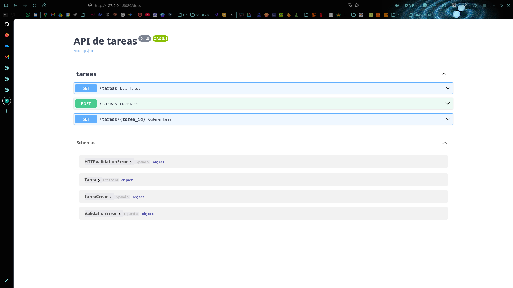
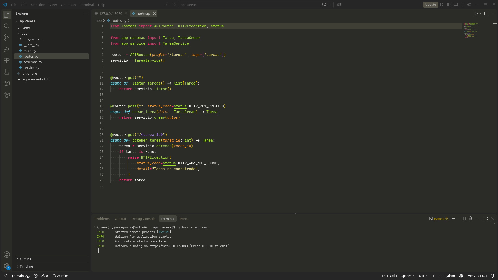
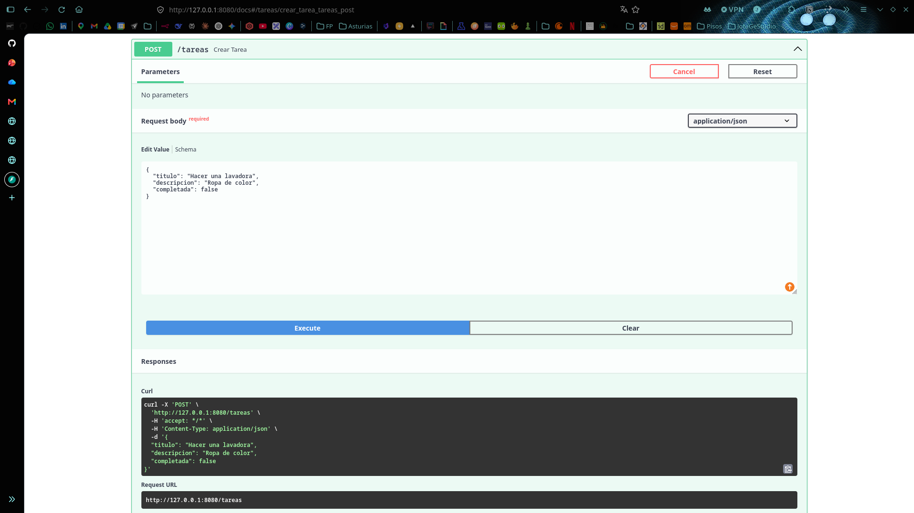
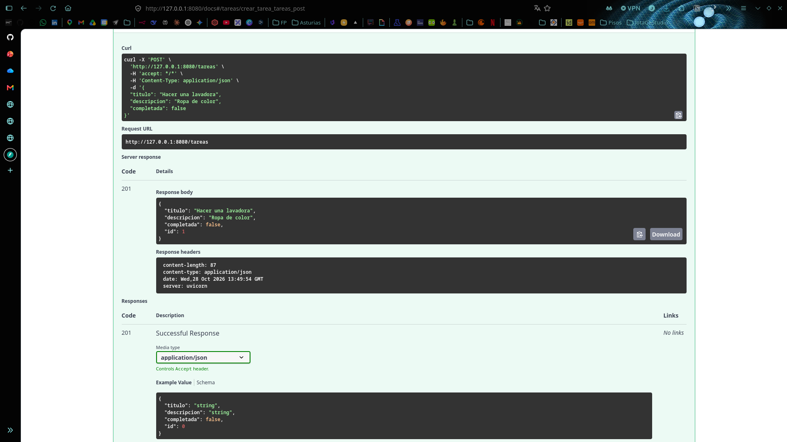
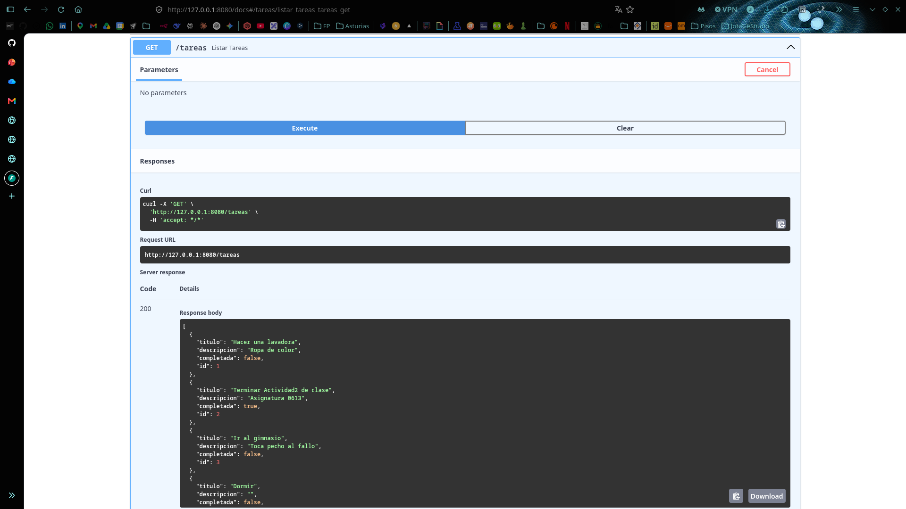
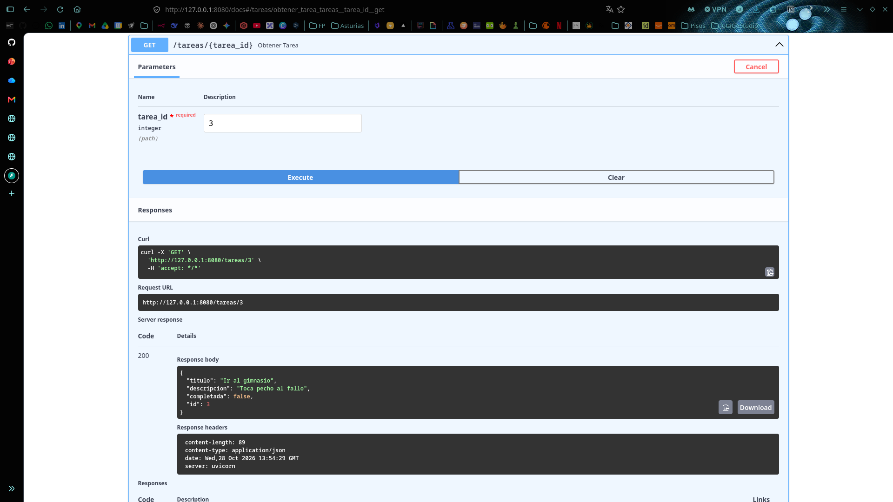
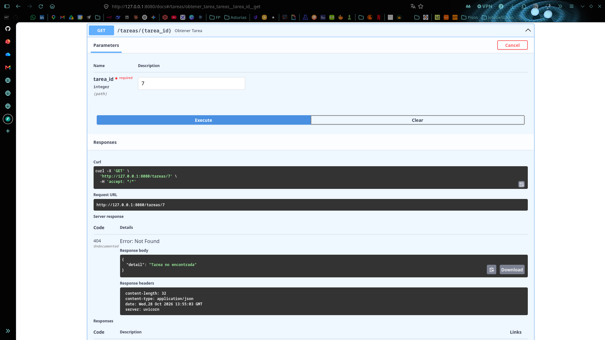
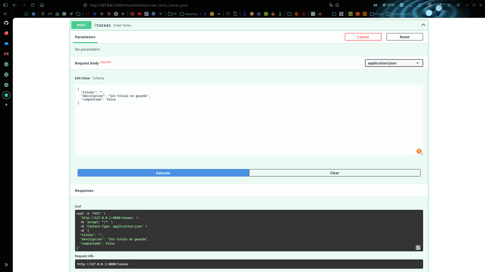
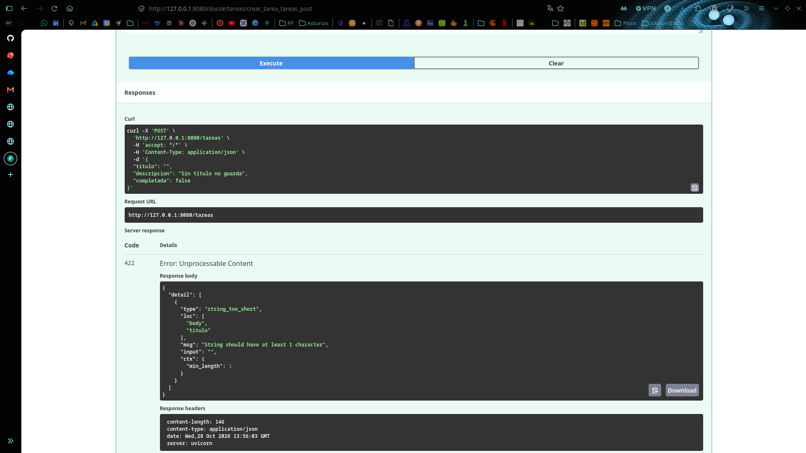

# api-tareas

Ejercicio del Bloque 2 de **0613 · Desarrollo web en entorno servidor** (2º DAW).

API REST de tareas con FastAPI. Tiene tres endpoints, valida los datos con modelos Pydantic, separa las rutas del servicio y devuelve códigos HTTP coherentes.

| Método | Ruta | Qué hace | Códigos |
|---|---|---|---|
| `GET` | `/tareas` | Lista todas las tareas | `200` |
| `POST` | `/tareas` | Crea una tarea | `201` · `422` si el cuerpo no es válido |
| `GET` | `/tareas/{id}` | Devuelve una tarea | `200` · `404` si no existe · `422` si el id no es un número |



## Cómo ejecutarlo

Desarrollado con Python 3.14, FastAPI 0.162 y uvicorn 0.54.

```bash
python3 -m venv .venv
source .venv/bin/activate
pip install -r requirements.txt
python -m app.main
```

La API queda en <http://localhost:8080>. La documentación interactiva (Swagger UI), desde la que se pueden probar los endpoints, está en <http://localhost:8080/docs>.

Hay que lanzarla con `-m` desde la raíz del proyecto. `python app/main.py` falla con `ModuleNotFoundError: No module named 'app'`, porque así Python busca los módulos dentro de `app/` y no encuentra el paquete. Para desarrollo, con recarga automática al guardar:

```bash
uvicorn app.main:app --reload --port 8080
```



## Ejemplo de petición y respuesta

Crear una tarea:

```bash
curl -X POST http://localhost:8080/tareas \
  -H "Content-Type: application/json" \
  -d '{"titulo": "Hacer una lavadora", "descripcion": "Ropa de color"}'
```

```http
HTTP/1.1 201 Created
content-type: application/json

{"titulo": "Hacer una lavadora", "descripcion": "Ropa de color", "completada": false, "id": 1}
```

Pedir una tarea que no existe:

```bash
curl http://localhost:8080/tareas/7
```

```http
HTTP/1.1 404 Not Found
content-type: application/json

{"detail": "Tarea no encontrada"}
```

Crear una tarea con el título vacío:

```bash
curl -X POST http://localhost:8080/tareas \
  -H "Content-Type: application/json" \
  -d '{"titulo": ""}'
```

```http
HTTP/1.1 422 Unprocessable Content
content-type: application/json

{"detail": [{"type": "string_too_short", "loc": ["body", "titulo"], "msg": "String should have at least 1 character", ...}]}
```

## Capas de la aplicación

```
api-tareas/
├── app/
│   ├── main.py       Arranque: crea la aplicación y monta las rutas
│   ├── routes.py     Capa HTTP: endpoints, códigos de estado y errores
│   ├── service.py    Capa de negocio: crear, listar y buscar tareas
│   └── schemas.py    Modelos Pydantic: forma y validación de los datos
├── requirements.txt
└── docs/capturas/
```

Cada capa tiene una sola responsabilidad y solo conoce a la que tiene debajo:

```
Cliente ──HTTP──▶ routes.py ──▶ service.py ──▶ dict en memoria
                    │  ▲             │
                    ▼  │             ▼
                  schemas.py    schemas.py
```

| Capa | Archivo | Responsabilidad |
|---|---|---|
| **Modelos** | `schemas.py` | `TareaCrear` es lo que envía el cliente: `titulo` (de 1 a 100 caracteres), `descripcion` opcional y `completada`. `Tarea` es lo que devuelve la API: lo mismo más el `id`. El `id` lo asigna el servidor, así que no forma parte del modelo de entrada. |
| **Rutas** | `routes.py` | Recibe la petición, deja que FastAPI valide el cuerpo con Pydantic, llama al servicio y traduce el resultado a HTTP. Por ejemplo, cuando el servicio devuelve `None`, la ruta responde `404`. |
| **Servicio** | `service.py` | Lógica de negocio y almacenamiento. No importa FastAPI ni conoce los códigos HTTP. Si los datos pasaran a una base de datos, este sería el único archivo que cambiaría. |
| **Arranque** | `main.py` | Crea la aplicación `FastAPI`, incluye el router y levanta uvicorn en el puerto 8080. |

### Recorrido de una petición

| Paso | Dónde ocurre en este proyecto |
|---|---|
| 1. **Petición** | El cliente (navegador, curl o Swagger) envía `POST /tareas` con un JSON. |
| 2. **Entrada** | FastAPI valida el cuerpo contra `TareaCrear`. Si no es válido, responde `422` y la petición no llega a ejecutar nuestro código. |
| 3. **Tratamiento** | `routes.py` llama a `TareaService.crear()`, que asigna el siguiente `id`. |
| 4. **Datos** | El servicio guarda la tarea en un diccionario en memoria. |
| 5. **Respuesta** | FastAPI serializa la `Tarea` a JSON y la devuelve con el código `201`. |
| 6. **Despliegue** | En producción, Nginx estaría delante de uvicorn (ver abajo). |

### Almacenamiento en memoria

Las tareas se guardan en un diccionario dentro del servicio, porque el ejercicio no pide base de datos. En consecuencia, **se pierden al reiniciar el servidor** y los ids vuelven a empezar en 1. Las rutas usan `async def` para que todas las peticiones se atiendan en un único hilo: así dos `POST` simultáneos no pueden recibir el mismo `id`.

## Relación con Nginx

uvicorn es un servidor de aplicaciones: entiende HTTP y ejecuta FastAPI, pero no está pensado para estar expuesto directamente a Internet. En un despliegue real, delante se pone **Nginx** como *proxy inverso*:

```
Internet ──:80/:443──▶ Nginx ──proxy_pass──▶ uvicorn 127.0.0.1:8080 ──▶ FastAPI
```

- **Nginx** recibe el tráfico público, gestiona HTTPS y los certificados, sirve los archivos estáticos y reenvía al backend las peticiones de la API.
- **uvicorn** escucha solo en `127.0.0.1`, así que desde fuera de la máquina no se puede acceder a él directamente: todo pasa por Nginx. Es la misma configuración que ya tiene `main.py`.

Una configuración mínima de Nginx para esta API (no se incluye en el repo; es solo de referencia):

```nginx
server {
    listen 80;
    server_name tareas.ejemplo.com;

    location / {
        proxy_pass http://127.0.0.1:8080;
        proxy_set_header Host $host;
        proxy_set_header X-Real-IP $remote_addr;
        proxy_set_header X-Forwarded-For $proxy_add_x_forwarded_for;
        proxy_set_header X-Forwarded-Proto $scheme;
    }
}
```

Las cabeceras `proxy_set_header` hacen que FastAPI siga conociendo el dominio, la IP real del cliente y si la petición llegó por HTTPS. Sin ellas, FastAPI vería todas las peticiones como si vinieran de Nginx.

## Pruebas

Probado a mano desde Swagger UI (`/docs`), en una misma sesión del servidor.

### `POST /tareas` → 201





### `GET /tareas` → 200



### `GET /tareas/{id}` → 200



### `GET /tareas/{id}` → 404



### `POST /tareas` con título vacío → 422






